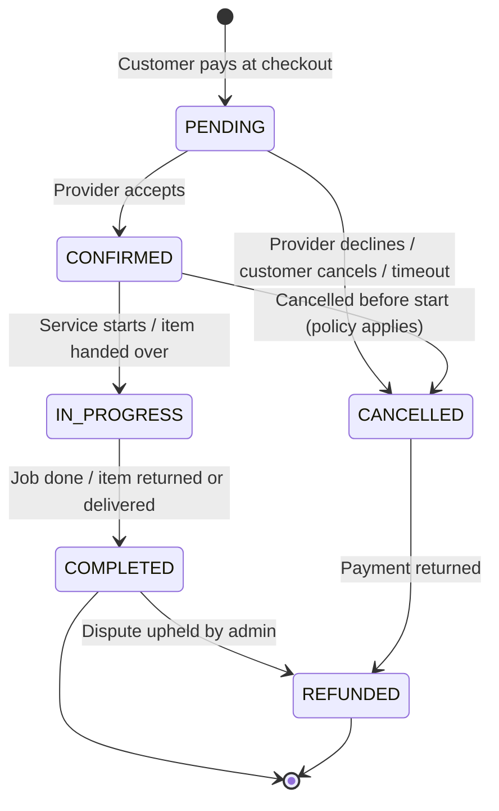

# L\*ease: UX Strategy

| Field | Value |
|---|---|
| Document ID | LEASE-DOC-01 |
| Status | Draft for review |
| Version | 0.1 |
| Related | [02-requirements-BABOK.md](./02-requirements-BABOK.md), [03-high-level-architecture.md](./03-high-level-architecture.md) |

> **Note:** This document is a working hypothesis. Personas, metrics and market assumptions must be checked with discovery interviews and usage data before they are treated as facts. Items marked **[Assumption]** have not been checked.

---

## 1. Product Vision

L\*ease is a two-sided marketplace. Customers use it to find, book, buy or temporarily use what they need, all in one place:

- **Services**: time-based work done by a provider, such as cleaning, repairs or tutoring.
- **Retail goods**: physical items sold outright.
- **Shared assets**: items lent or rented for a period, such as tools, equipment or vehicles.

Providers (individuals or small businesses) get one storefront, one order pipeline and one reputation for all three.

These three offer types match the `ListingType` enum in the data model (`SERVICE`, `RETAIL`, `ASSET`). The UX treats them as **variants of one listing experience**, not three separate products.

**Vision statement:** *"Anything you need, from anyone you trust, on your terms: buy it, book it or borrow it."*

---

## 2. Lean Canvas

| Block | Content |
|---|---|
| **1. Problem** | 1. Customers juggle separate apps for services, second-hand or local retail, and rentals or sharing, and trust signals differ across them.   2. Small providers lack one affordable channel to sell services, goods and idle assets, so they rely on social media DMs and cash, with no payment protection.   3. Peer-to-peer deals often fail on trust: no-shows, item condition disputes, late or no payment. |
| **Existing alternatives** | Generic classifieds sites, social-media marketplace groups, single-vertical service platforms, single-vertical rental platforms, word of mouth. |
| **2. Customer Segments** | **Customers:** urban and suburban residents aged 22 to 55 who are digitally comfortable and prefer access over ownership.   **Providers:** freelancers, sole traders, micro-businesses and asset owners with idle equipment.   **Early adopters [Assumption]:** people in one pilot city who already rent or lend tools and equipment peer-to-peer and hire local services online. |
| **3. Unique Value Proposition** | **One trusted marketplace to buy, book or borrow locally, with protected payments and verified reviews tied to real orders.**   *High-level concept:* "a local multi-vertical marketplace with escrow-style payments." |
| **4. Solution** | 1. A single listing model with type-specific fields (`metadata`) for services, retail and assets.   2. Protected checkout: payment is captured upfront and the order follows a clear status lifecycle (`PENDING` → `CONFIRMED` → `IN_PROGRESS` → `COMPLETED`, plus `CANCELLED` and `REFUNDED`).   3. Verified reviews: only one review per completed order (`Review.orderId` is unique), rating both the listing and the provider.   4. A provider dashboard covering listings, incoming orders and earnings. |
| **5. Channels** | Local SEO and listing pages that search engines can index; supply-side outreach to providers (local business associations, maker spaces, trade schools); referral credits for both sides; partnerships such as property managers and co-working spaces; app stores (future Flutter app); community events in the pilot city. |
| **6. Revenue Streams** | 1. Commission (take rate) on each completed order **[Assumption: 8–15% depending on `ListingType`]**.   2. Customer service fee per order (a small flat fee or a percentage).   3. Provider subscription ("Pro") for promoted listings, analytics and lower commission.   4. Optional damage protection or deposit-handling fee for `ASSET` rentals (future). |
| **7. Cost Structure** | Cloud hosting and managed PostgreSQL; payment processing fees; customer support and dispute handling; provider acquisition and marketing; KYC and identity verification (future); engineering and design salaries; legal and compliance (GDPR, consumer protection, platform-worker rules). |
| **8. Key Metrics** | **North Star:** completed orders per month (`Order.status = COMPLETED`).   **Acquisition:** new active listings per week; activation rate (sign-up → first listing or first order).   **Liquidity:** search-to-order conversion; share of listings with at least one order in 30 days; time to first order for new providers.   **Trust:** average rating; dispute rate; cancellation rate; refund rate.   **Economics:** GMV (sum of `Order.amount` where `COMPLETED`), take rate, CAC per side, contribution margin per order.   **Retention:** 30/90-day repeat-order rate for customers; provider monthly active rate. |
| **9. Unfair Advantage** | *To be earned, not assumed.* Candidates: (a) a cross-vertical reputation graph, where a provider's reputation carries across services, retail and assets; (b) a dense local supply in the pilot city that creates network effects; (c) proprietary trust data (completion and dispute history per user) that improves matching and risk scoring. |

---

## 3. User Personas

The platform serves three roles (`Role` enum): `CUSTOMER`, `PROVIDER` and `ADMIN`. A single `User` holds exactly one role at a time. The two primary marketplace personas are below. The admin persona is internal and appears briefly in §3.3.

### 3.1 Customer Persona: "Mila, the pragmatic urbanite"

| Attribute | Detail |
|---|---|
| Age / Occupation | 31, marketing specialist, hybrid remote |
| Location | Rented apartment in a mid-sized EU city (prices in EUR) |
| Tech profile | Mobile-first, pays with cards and wallets, uses 3–4 marketplace apps |
| Context | Recently moved and furnished on a budget. Needs occasional services (handyman, cleaning) and short-term tools (drill, ladder, projector). Prefers not to buy things she will use once. |
| Goals | Get things done quickly; pay a fair, transparent price; avoid being scammed; not waste weekends chasing replies |
| Frustrations | Unanswered messages and no-shows; unclear total price (hidden fees, deposits); fake or unverifiable reviews; paying cash to strangers with no recourse |
| Behaviors | Compares 2–3 options and reads the 3 most recent reviews; books within 24 hours of the need appearing; abandons checkout if forced to register before seeing the price |
| Success looks like | "I found a verified provider, paid in-app, and it was done or delivered when promised. If not, I got my money back." |
| Quote | *"I don't need to own a drill. I need a hole in the wall by Saturday."* |

### 3.2 Provider Persona: "Marko, the multi-skill micro-entrepreneur"

| Attribute | Detail |
|---|---|
| Age / Occupation | 42, self-employed handyman and carpenter |
| Business | Sole trader. Owns a van and professional tools that sit idle about 40% of the week. Sometimes sells hand-made furniture. |
| Tech profile | Android phone, uses messaging apps and social media for leads, little time for admin |
| Context | Gets work from word of mouth and social groups. Wants to also rent out tools and sell furniture without running three separate channels. |
| Goals | Fill his calendar; earn from idle tools; get paid reliably and fast; build a reputation that wins better-paying jobs |
| Frustrations | Clients who cancel last minute or haggle after the job; chasing payments; tools returned damaged; platform fees that feel opaque |
| Behaviors | Responds to leads from his phone between jobs; updates prices rarely; values a simple weekly payout summary |
| Success looks like | "Orders come to me already paid, I confirm with one tap, and my 4.9★ rating shows up on everything I offer." |
| Quote | *"If the money is safe and the client is serious, I'll take the job."* |

### 3.3 Supporting Persona: "Ana, the trust & safety admin" (internal)

Ana handles disputes, refunds, listing moderation and suspicious accounts. She needs searchable order history, an audit trail of status changes, and tools to deactivate listings (`Listing.isActive = false`) or refund orders (`OrderStatus.REFUNDED`).

---

## 4. User Needs & Jobs-to-be-Done (JTBD)

### 4.1 Job Statements

Format: *When [situation], I want to [motivation], so I can [expected outcome].*

**Customer jobs**

| ID | Job type | Job statement |
|---|---|---|
| C-J1 | Functional (core) | When I have a household task I can't or won't do myself, I want to book a qualified local provider at a known price, so I can get it done without hassle. |
| C-J2 | Functional | When I need an item for a short time, I want to rent it nearby instead of buying it, so I can save money and storage space. |
| C-J3 | Functional | When I want to buy a specific item locally, I want to purchase it with protected payment, so I can avoid fraud. |
| C-J4 | Emotional | When I hand over money to a stranger, I want to feel confident they are legitimate, so I can avoid anxiety and regret. |
| C-J5 | Social | When I recommend a provider to friends, I want my recommendation to hold up, so I can look reliable myself. |

**Provider jobs**

| ID | Job type | Job statement |
|---|---|---|
| P-J1 | Functional (core) | When I have free capacity or idle assets, I want to reach nearby customers who are ready to pay, so I can turn spare time and equipment into income. |
| P-J2 | Functional | When a customer orders, I want the payment secured before I commit, so I can avoid no-shows and unpaid work. |
| P-J3 | Functional | When I offer different kinds of things (services, goods, rentals), I want to manage them in one place, so I can save admin time. |
| P-J4 | Emotional / Social | When I do good work, I want it reflected in a visible reputation, so I can win more and better-paid work. |

### 4.2 Desired Outcomes (prioritized)

These are outcome statements in Outcome-Driven Innovation style. Importance and satisfaction are **[Assumption]** values on a 1–5 scale until survey data replaces them. Opportunity = Importance + max(Importance − Satisfaction, 0).

| Outcome | Persona | Importance | Satisfaction (today) | Opportunity |
|---|---|---|---|---|
| Minimize the time to find a trustworthy provider | Customer | 5 | 2 | 8 |
| Minimize the risk of paying and not receiving the service or item | Customer | 5 | 2 | 8 |
| Minimize the uncertainty about total price before committing | Customer | 4 | 2 | 6 |
| Minimize unpaid or cancelled jobs | Provider | 5 | 2 | 8 |
| Minimize the admin effort to manage offers across types | Provider | 4 | 1 | 7 |
| Maximize the visibility of earned reputation | Provider | 4 | 2 | 6 |
| Minimize the time to resolve a dispute | Both | 4 | 1 | 7 |

### 4.3 Needs → Capability Mapping

| Need | Product capability | Requirement module |
|---|---|---|
| Trust in counterpart | Verified accounts, reviews tied to completed orders, provider profile with aggregate rating | M1, M4 |
| Find the right offer fast | Search and filter by `ListingType`, price and keyword; active-only results | M2 |
| Price transparency | Final `amount` and `currency` shown before payment | M3 |
| Payment protection | Payment captured at checkout (`paymentIntentId`), status lifecycle, refunds | M3 |
| One storefront for all offer types | Unified listing CRUD with type-specific `metadata` | M2 |
| Reputation growth | Ratings aggregated per provider (`reviewsReceived`) and per listing | M4 |
| Safe asset sharing | Rental period, deposit and condition check-in/out (future extension) | M4 |

---

## 5. Information Architecture (IA)

### 5.1 Design Principles

1. **One listing, three behaviors.** Shared layout; the CTA and detail fields change by `ListingType` (Book / Buy / Rent).
2. **Price before profile.** Guests can browse and see full pricing. Authentication is required only at checkout.
3. **Role-adaptive navigation.** The same app shows customer or provider navigation based on `User.role`.
4. **Trust everywhere.** Rating, review count and verification badge appear on every listing card and detail page.
5. **Mobile-first.** Primary layouts target the future Flutter mobile app. The web uses the same IA.

### 5.2 Sitemap

```mermaid
graph TD
    Root["L*ease"] --> Public
    Root --> CustomerArea["Customer area (role: CUSTOMER)"]
    Root --> ProviderArea["Provider area (role: PROVIDER)"]
    Root --> AdminArea["Admin console (role: ADMIN)"]

    Public --> Home["Home / Discover"]
    Public --> Search["Search & Filters<br/>type · price · keyword"]
    Public --> Category["Browse by type<br/>Services · Retail · Assets"]
    Public --> ListingDetail["Listing detail<br/>price · metadata · reviews · provider"]
    Public --> ProviderProfile["Provider public profile<br/>listings · rating · reviews"]
    Public --> Auth["Sign up / Log in"]
    Public --> Help["Help · Terms · Privacy"]

    CustomerArea --> Checkout["Checkout"]
    CustomerArea --> MyOrders["My orders<br/>status timeline"]
    MyOrders --> OrderDetail["Order detail"]
    OrderDetail --> WriteReview["Write review<br/>(COMPLETED only)"]
    CustomerArea --> CustAccount["Account & settings"]

    ProviderArea --> Dashboard["Dashboard<br/>KPIs · pending actions"]
    ProviderArea --> MyListings["My listings"]
    MyListings --> ListingEditor["Create / edit listing<br/>type-specific fields"]
    ProviderArea --> IncomingOrders["Incoming orders<br/>confirm · start · complete"]
    ProviderArea --> Earnings["Earnings & payouts"]
    ProviderArea --> ProvReviews["Reviews received"]
    ProviderArea --> ProvAccount["Account & settings"]

    AdminArea --> Users["Users"]
    AdminArea --> Moderation["Listing moderation"]
    AdminArea --> OrdersAdmin["Orders & refunds"]
    AdminArea --> ReviewsAdmin["Review moderation"]
```

### 5.3 Core Content Model (UX view of the data model)

| UX object | Backing entity | Key attributes shown to users |
|---|---|---|
| Account / Profile | `User` | firstName, lastName, role, member since (`createdAt`), aggregate rating |
| Listing card | `Listing` | title, price, type badge, provider name, rating, review count |
| Listing detail | `Listing` + `metadata` | description, price, type-specific fields (see §5.4), availability (future), reviews |
| Order | `Order` | amount, currency, status timeline, listing snapshot, counterpart |
| Review | `Review` | rating (1–5), comment, author first name, date, linked listing |

### 5.4 Type-Specific Listing Fields (stored in `Listing.metadata`)

| `ListingType` | Primary CTA | Suggested `metadata` keys **[Proposed]** |
|---|---|---|
| `SERVICE` | **Book** | `durationMinutes`, `serviceArea`, `pricingUnit` (`fixed`/`hour`), `availability` |
| `RETAIL` | **Buy** | `condition` (`new`/`used`), `stockQuantity`, `deliveryOptions`, `brand` |
| `ASSET` | **Rent** | `pricingUnit` (`day`/`week`), `depositAmount`, `minRentalDays`, `pickupLocation`, `conditionNotes` |

### 5.5 Navigation Model

| Role | Primary navigation (bottom tab bar on mobile) |
|---|---|
| Guest | Discover · Search · Log in |
| `CUSTOMER` | Discover · Search · Orders · Account |
| `PROVIDER` | Dashboard · Listings · Orders · Earnings · Account |
| `ADMIN` | Web console only: Users · Listings · Orders · Reviews |

---

## 6. User Journey Maps

### 6.1 Customer Journey: "Rent a drill for the weekend" (`ASSET`)

| Stage | Discover | Evaluate | Checkout | Wait / Fulfil | Use & Return | Review |
|---|---|---|---|---|---|---|
| **Customer action** | Searches "drill" and filters to Assets | Opens 2–3 listings, compares price, deposit and rating | Logs in or signs up, sees total, pays | Gets confirmation, arranges pickup | Picks up, uses, returns | Rates provider and item |
| **Touchpoint** | Search, filters, listing cards | Listing detail, provider profile, reviews | Auth, checkout | Order detail, notifications | Order detail (status `IN_PROGRESS`) | Write review screen |
| **System state** | `Listing.isActive = true`, `type = ASSET` | n/a | `Order` created (`PENDING`, `paymentIntentId` set) | `CONFIRMED` by provider | `IN_PROGRESS` → `COMPLETED` | `Review` created (one per order) |
| **Emotion** | Curious | Cautious | Anxious about paying a stranger | Reassured | Satisfied | Empowered |
| **Pain points** | Too many irrelevant results | Unclear deposit or condition | Forced sign-up; hidden fees | Slow provider response | Disagreement over condition on return | Forgetting to review |
| **Opportunities** | Smart defaults; location sorting (future) | Show total price including deposit upfront; verified badge | Guest browsing; one-page checkout; wallet payments | Confirmation reminders and SLA for providers (e.g. 2 hours) | Photo check-in/out (future); clear dispute path | Review prompt when the order becomes `COMPLETED` |

### 6.2 Provider Journey: "List and fulfil a service" (`SERVICE`)

| Stage | Onboard | List | Receive order | Fulfil | Get paid | Grow |
|---|---|---|---|---|---|---|
| **Provider action** | Signs up as provider | Creates a service listing with price and area | Gets notified, reviews request | Starts and completes job | Sees earnings | Reads reviews, adjusts offer |
| **Touchpoint** | Sign-up (role `PROVIDER`) | Listing editor | Incoming orders | Order detail actions | Earnings | Reviews received, dashboard |
| **System state** | `User.role = PROVIDER` | `Listing` created, `isActive = true` | `Order.status = PENDING` | `CONFIRMED` → `IN_PROGRESS` → `COMPLETED` | Payout scheduled (future) | Aggregate rating updated |
| **Emotion** | Skeptical about fees | Hopeful | Excited | Focused | Relieved | Motivated |
| **Pain points** | Unclear commission | Too many required fields | Low-quality requests | Customer no-show | Payout delays | Unfair review |
| **Opportunities** | Transparent fee calculator | Templates per `ListingType`; save draft | Payment secured before confirm | Cancellation policy enforced | Clear payout schedule | Right-of-reply to reviews (future) |

### 6.3 Order Lifecycle as Experienced by Both Sides

---

## 7. UX Success Metrics (HEART)

| Dimension | Goal | Signal | Metric (initial target **[Assumption]**) |
|---|---|---|---|
| Happiness | Users trust the platform | Post-order rating, NPS | Average review rating ≥ 4.5; NPS ≥ 40 |
| Engagement | Users return to transact | Orders per active customer | ≥ 1.5 orders per active customer per quarter |
| Adoption | New users transact | Sign-up → first order or listing | ≥ 25% customers order within 14 days; ≥ 60% providers publish within 7 days |
| Retention | Both sides stay | Repeat order / active provider | 90-day customer repeat ≥ 30%; provider MAU retention ≥ 70% |
| Task success | Checkout and fulfilment work | Funnel completion, cancellation rate | Checkout completion ≥ 70%; cancellation ≤ 8% |

---

## 8. Open Research Questions

1. Which `ListingType` should launch first in the pilot to reach liquidity fastest, or should all three launch together?
2. Will providers accept payment-before-confirmation with a confirmation SLA, and what SLA is acceptable?
3. How do customers perceive deposits for `ASSET` rentals: a pre-authorization hold or a captured charge?
4. Can one person act as both customer and provider? The current model allows **one** `Role` per `User`. This needs a decision: multi-role support or separate accounts.
5. What level of identity verification do providers accept during onboarding without abandoning it?
