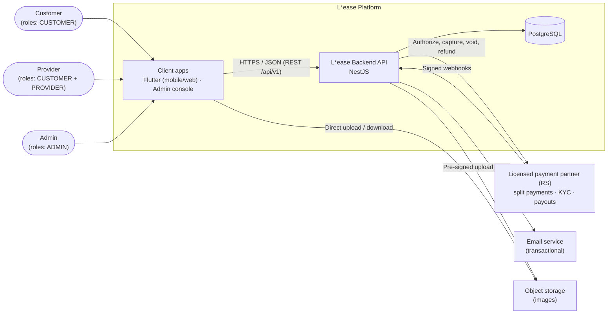
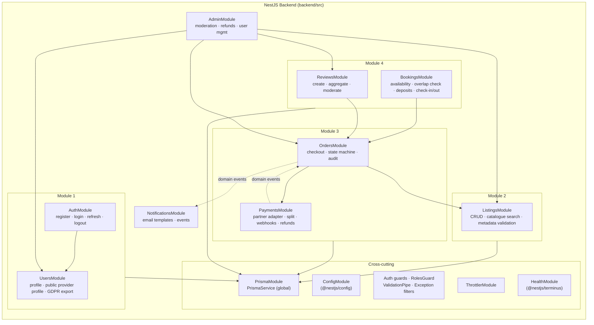
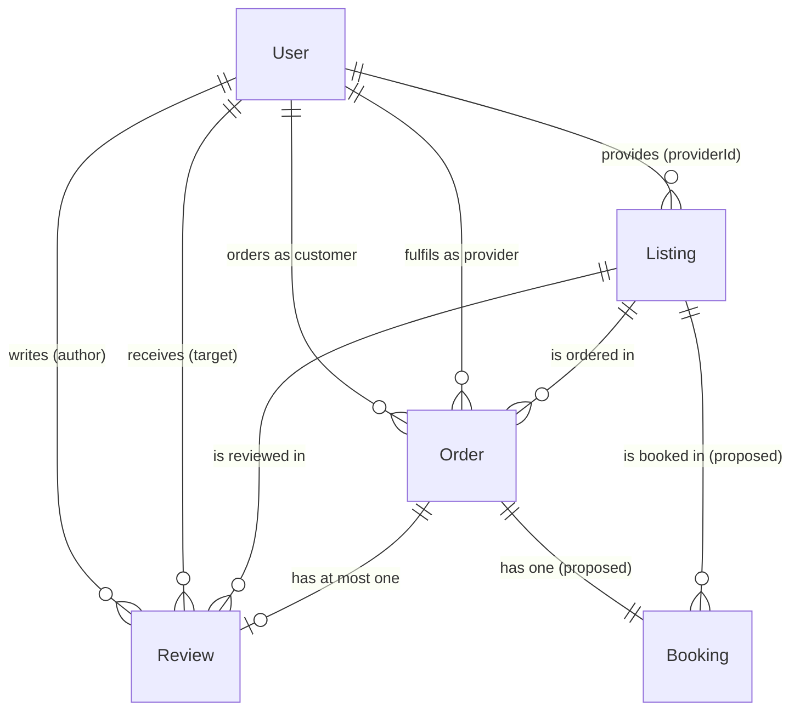
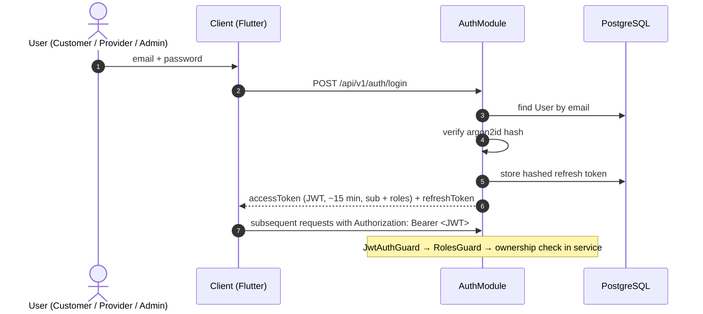
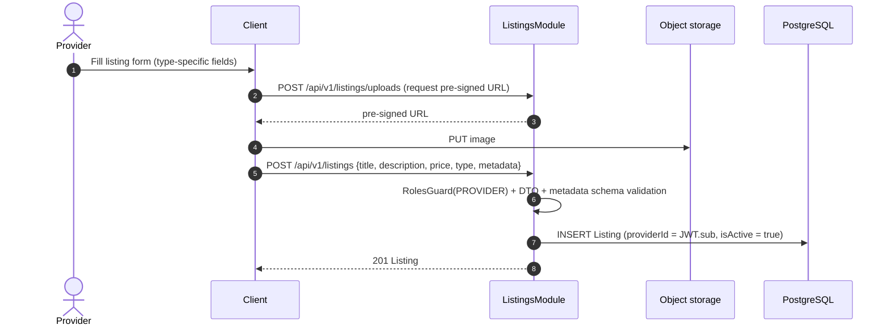
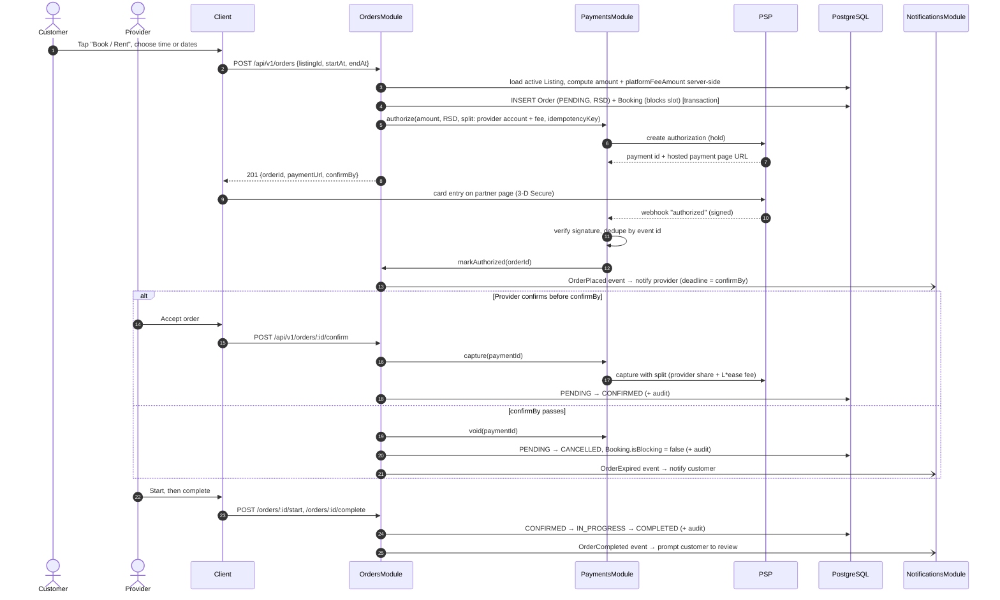
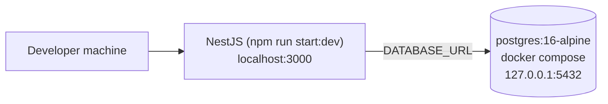
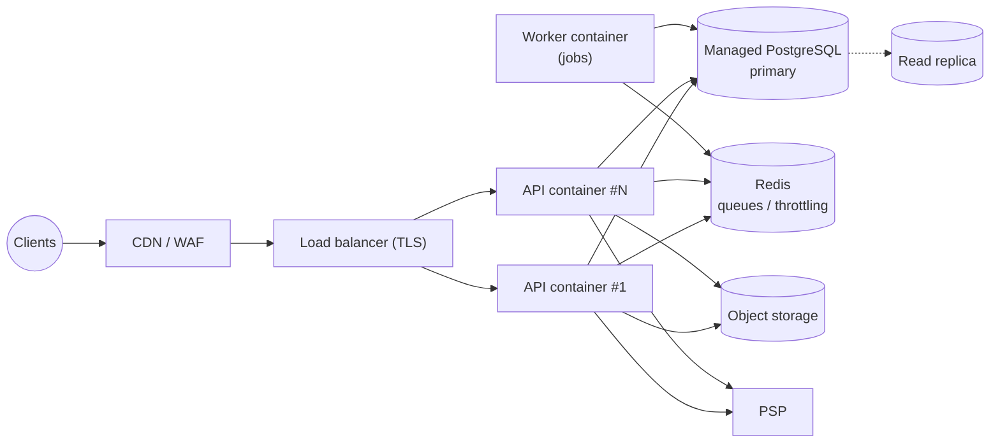

# L\*ease: High-Level Architecture (HLA)

| Field | Value |
|---|---|
| Document ID | LEASE-DOC-03 |
| Status | Draft for review |
| Version | 0.2 |
| Related | [00-product-decisions.md](./00-product-decisions.md), [01-ux-strategy.md](./01-ux-strategy.md), [02-requirements-BABOK.md](./02-requirements-BABOK.md) |

---

## 1. Overview

L\*ease is an API-first, modular monolith:

- **Backend core**: a single NestJS (TypeScript, ESM) application that exposes a versioned REST API.
- **System of record**: PostgreSQL, accessed through Prisma ORM.
- **Packaging**: Docker for both local development and deployment.
- **Clients**: all clients use the same API. This includes the future **Flutter** mobile/web app and an admin web console.

A **modular monolith** was chosen over microservices for the MVP for these reasons:

- One deployable unit and one database transaction boundary for the order lifecycle, which keeps money handling simple and consistent.
- NestJS feature modules give strong internal boundaries that map 1:1 to the requirement modules (M1–M4).
- A module can be split into its own service later, once load or team size justifies it (see §7.3).

### 1.1 Current State (Phase 1, implemented)

| Item | Location | State |
|---|---|---|
| NestJS app scaffold | `backend/src` | `AppModule` with global `PrismaModule` / `PrismaService` |
| Data model | `backend/prisma/schema.prisma` | `User`, `Listing`, `Order`, `Review`; enums `Role`, `ListingType`, `OrderStatus` |
| Initial migration | `backend/prisma/migrations/*_init` | Applied with `prisma migrate dev` |
| Local database | `docker-compose.yml` | `postgres:16-alpine`, bound to `127.0.0.1:5432` |

Everything else in this document is **target architecture** for later phases. It reflects the pilot decisions in [00-product-decisions.md](./00-product-decisions.md): multi-role accounts (D-01), `SERVICE` + `ASSET` (D-02), RSD (D-03), a licensed payment partner with split payments (D-04) and a shared `Booking` model (D-06).

---

## 2. Architectural Drivers

| Driver | Source | Architectural response |
|---|---|---|
| Money must be consistent | NFR-REL-01, FR-M3-* | Single PostgreSQL, Prisma transactions, `Decimal(10,2)`, idempotent webhooks |
| Multiple clients (Flutter, web, admin) | BR-07, NFR-INT-01 | Stateless REST API `/api/v1`, OpenAPI contract, JWT auth |
| Strict authorization (two-sided + admin) | FR-M1-07, NFR-SEC-03 | RBAC guards + object-level ownership checks in services |
| Iterative, spec-driven delivery | §2.5 of requirements | One NestJS feature module per requirement module |
| Small team, low ops budget | Business context | Modular monolith, managed Postgres, containerized deploy |
| ZZPL (GDPR-style) / PCI scope | NFR-PRI-*, NFR-SEC-06 | Data minimization, partner-hosted payment page (SAQ-A), anonymization |
| L\*ease must not hold customer funds | D-04 | Licensed partner authorizes, captures, splits and pays out; L\*ease stores only payment ids and fee snapshots |

---

## 3. System Context (C4 Level 1)



---

## 4. Component Architecture (C4 Levels 2–3)

### 4.1 Containers

| Container | Technology | Responsibility | Status |
|---|---|---|---|
| **Flutter app** | Flutter (Dart), iOS / Android / Web | Customer and provider UX (see UX IA) | Future |
| **Admin console** | Flutter Web or a lightweight web SPA | Moderation, refunds, user management | Future |
| **Backend API** | Node.js 22, NestJS 12 (ESM), Express adapter | Business logic, auth, orchestration, integrations | Phase 1 scaffold |
| **Database** | PostgreSQL 16 | System of record | Phase 1 |
| **ORM** | Prisma 6.x (`prisma-client-js`) | Type-safe data access, migrations | Phase 1 |
| **Background jobs** | `@nestjs/schedule` (MVP) → `@nestjs/bullmq` + Redis | Confirmation-deadline cancellations (FR-M3-08), emails, webhook retries | Future |
| **Cache / rate-limit store** | Redis (optional in MVP) | Throttling, queues, hot catalogue caching | Future |
| **Containerization** | Docker, Docker Compose | Local dev parity, deployable images | Phase 1 (DB only) |

### 4.2 Backend Components (NestJS Modules)



**Module conventions:**

- Each module owns its **controller** (HTTP), **service** (business rules) and **DTOs** (validation). Access to Prisma models goes through `PrismaService`.
- A module may call another module **only through its exported service**, never through the other module's tables directly. For example, `OrdersModule` calls `ListingsService.getOrderableListing()` and does not query `Listing` itself. This keeps a future extraction to a separate service feasible.
- Side effects such as emails and the review prompt on `COMPLETED` are triggered through **domain events** (`@nestjs/event-emitter` in MVP). The transactional outbox pattern is planned once queues are introduced.
- Relative imports end in `.js` (ESM), following the project convention.

### 4.3 Data Model Ownership



| Model | Owning module | Notes |
|---|---|---|
| `User` | UsersModule (written by AuthModule on register) | `password` never leaves the service layer |
| `Listing` | ListingsModule | `metadata` JSON validated per `ListingType` |
| `Order` | OrdersModule (PaymentsModule writes `paymentIntentId`) | Status changes only through the state machine |
| `Review` | ReviewsModule | Created only for `COMPLETED` orders |
| `Booking` | BookingsModule | **Proposed** (D-06). Exclusion constraint prevents overlapping bookings per listing |
| `OrderStatusEvent` | OrdersModule | **Proposed** audit model (FR-M3-06) |

---

## 5. Data Flows Between Actors and the Backend Core

### 5.1 Authentication (all actors)



### 5.2 Provider Publishes a Listing



### 5.3 Customer Checkout and Order Lifecycle



### 5.4 Review After Completion

`Customer → POST /api/v1/orders/:id/review {rating, comment}`. `ReviewsModule` then:

1. Checks that the caller is `order.customerId` and that `order.status = COMPLETED`.
2. Inserts the `Review` with `authorId`, `targetId` and `listingId` taken from the order. Uniqueness on `orderId` prevents duplicates.
3. Invalidates the cached rating aggregates for the listing and the provider.

### 5.5 Admin Flows

| Flow | Path | Effect |
|---|---|---|
| Moderate listing | `PATCH /api/v1/admin/listings/:id {isActive:false, reason}` | Listing hidden from catalogue and not orderable |
| Refund order | `POST /api/v1/admin/orders/:id/refund` | PaymentsModule → PSP refund → webhook → `REFUNDED` |
| Suspend user | `PATCH /api/v1/admin/users/:id {suspended:true}` | Tokens revoked; listings deactivated **[requires `User.status` field, proposed]** |
| Moderate review | `PATCH /api/v1/admin/reviews/:id {hidden:true, reason}` | Excluded from aggregates **[requires `Review.hidden`, proposed]** |

### 5.6 Actor × Capability Matrix (authorization summary)

Permissions are per role. A user holding several roles (D-01) gets the union of their permissions.

| Capability | Guest | CUSTOMER | PROVIDER | ADMIN |
|---|---|---|---|---|
| Browse / search active listings | ✔ | ✔ | ✔ | ✔ |
| Create / edit own listings | n/a | n/a | ✔ (own) | ✔ (any, moderation) |
| Create order | n/a | ✔ (not on own listings) | (as customer) | n/a |
| View order | n/a | ✔ (own as customer) | ✔ (own as provider) | ✔ |
| Transition order | n/a | cancel (own) | confirm / start / complete / cancel (own) | cancel / refund (any) |
| Write review | n/a | ✔ (own completed order) | n/a | n/a |
| Moderate users / reviews | n/a | n/a | n/a | ✔ |

---

## 6. Security Guidelines

| Area | Guideline |
|---|---|
| **Transport** | TLS everywhere (terminated at load balancer / ingress); HSTS; no plain HTTP in prod. |
| **Authentication** | argon2id password hashing; JWT access tokens (≤ 15 min, claims: `sub`, `roles`); rotating refresh tokens stored **hashed** and revocable. Signing keys from secret manager; plan for key rotation. |
| **Authorization** | Deny by default. Global `JwtAuthGuard` with explicit `@Public()` opt-out. `RolesGuard` checks that `roles` contains a required role. **Object-level checks in services** (e.g. `listing.providerId === user.id`) to prevent BOLA/IDOR. |
| **Input validation** | DTO validation on every endpoint, using Standard Schema (Zod) with Nest's `StandardSchemaValidationPipe`, or `class-validator`. Whitelist properties and reject unknown fields. Validate `metadata` JSON per type. |
| **Mass assignment** | Never pass request bodies straight into Prisma `create`/`update`. Server-controlled fields (`roles`, `providerId`, `amount`, `platformFeeAmount`, `status`, `authorId`) are set only by services. |
| **Injection** | Prisma parameterizes queries. Raw SQL (`$queryRaw`) only with tagged templates, never string concatenation. |
| **Payments** | Partner-hosted card entry (SAQ-A). Verify webhook signatures. Idempotency keys on outbound partner calls. Dedupe inbound events by event id. Funds never pass through L\*ease accounts (D-04). |
| **Rate limiting & abuse** | `@nestjs/throttler` globally, stricter on `/auth/*`. Lock accounts after repeated failures. CAPTCHA on sign-up if abuse appears. |
| **Secrets & config** | `@nestjs/config` with validated env schema. `.env` git-ignored (already in `backend/.gitignore`). No secrets in images or logs. |
| **Data protection** | Minimize PII. Encrypt DB at rest (managed Postgres). Back up with encryption. GDPR export/delete, implemented as anonymization when financial records must be kept. |
| **HTTP hardening** | `helmet` headers, strict CORS allow-list (Flutter web origin, admin origin), body size limits. |
| **Supply chain** | Lockfile committed. Dependency audit in CI. Pin base images by digest in production. Run containers as non-root. |
| **Network** | Database not publicly exposed. The local compose binds Postgres to `127.0.0.1` only. In production, the DB is in a private subnet. |
| **Audit** | Order status audit trail (FR-M3-06) and admin action log. |

---

## 7. Scalability Guidelines

### 7.1 Application Tier

- Keep the API **stateless**: no in-memory sessions, and uploads go directly to object storage. Scale horizontally with N replicas behind a load balancer.
- Run scheduled jobs on **one** instance (leader election / `@nestjs/locks`) or move them to a dedicated worker container that uses the same image with a different entrypoint.
- Keep long-running or external work off the request path. Use queues (`@nestjs/bullmq` + Redis) for emails, webhook processing retries and confirmation-deadline cancellations.

### 7.2 Data Tier

- Existing indexes support the main access paths: `Listing(type)`, `Listing(providerId)`, `Order(customerId)`, `Order(providerId)`, `Order(status)`, `Review(listingId)`. Add composite indexes based on real query plans, e.g. `Listing(isActive, type, createdAt)` for the catalogue.
- Note: `User.email` has both `@unique` and `@@index([email])`. The unique constraint already creates an index, so the extra index can be dropped in a later migration.
- Use **connection pooling** (PgBouncer or Prisma Accelerate) once replicas × pool size approaches the Postgres `max_connections`.
- Add **read replicas** for catalogue and search traffic when needed. Writes (orders, payments) always go to the primary.
- Full-text search: start with PostgreSQL `tsvector` + GIN index. Move to a dedicated search engine only if relevance or scale requires it.
- Store rating aggregates as denormalized columns or a materialized view, refreshed on review events, so that aggregates are not computed per request.

### 7.3 Evolution Path

| Trigger | Step |
|---|---|
| > ~200 req/s sustained or team > 2 squads | Extract `PaymentsModule` / `NotificationsModule` into separate services using the outbox + message broker |
| Search latency issues | Dedicated search index fed by listing events |
| Multi-region demand | CDN for static/media; regional read replicas; revisit data residency (GDPR) |

---

## 8. Integration Guidelines

| Integration | Pattern | Notes |
|---|---|---|
| **Client ↔ API** | REST/JSON over HTTPS, `/api/v1`, OpenAPI 3 generated with `@nestjs/swagger` | Generate the Flutter (Dart) API client from the OpenAPI spec so the contract stays in sync. Cursor or offset pagination with `total`. Errors use a consistent `{ code, message, details }` envelope; clients translate `code` into `sr-Latn` or `en` (D-11). |
| **Payments (licensed partner, D-04)** | Outbound API calls with idempotency keys. Inbound signed webhooks at `POST /api/v1/payments/webhook` (raw body needed for signature check). | Hide the partner behind a `PaymentGateway` interface in `PaymentsModule` (`authorize`, `capture`, `void`, `refund`, `onboardProvider`) so that PaySpot, Monri or another partner can be swapped or mocked in tests. Store only partner ids (`paymentIntentId`, provider account id), never card data. |
| **Email** | Provider-agnostic `Mailer` interface (e.g. `@nestjs/mail`), event-driven | Templates per event (order status change, password reset, review prompt). |
| **Object storage** | S3-compatible, pre-signed URLs | Validate content type and size; strip EXIF location data from images. |
| **Webhooks out** (future) | `@nestjs/webhooks` | For partner integrations (e.g. property managers). |
| **Observability** | Structured logs (JSON) + request IDs, health checks (`@nestjs/terminus`), error tracking / APM | Never log PII, tokens or full payment ids. |

**API versioning policy:** additive changes are allowed within `v1`. Breaking changes require `v2`, which runs alongside `v1` for a deprecation window (minimum 3 months for mobile clients).

---

## 9. Deployment View

### 9.1 Local Development (current)



```bash
docker compose up -d
cd backend && cp .env.example .env && npm install
npx prisma migrate dev
npm run start:dev
```

### 9.2 Target Production (indicative)



**Release pipeline:** PR → CI (lint, unit, e2e against an ephemeral Postgres) → build Docker image → `prisma migrate deploy` → rolling deploy → health check gate.

**Planned repository additions:** `backend/Dockerfile` (multi-stage, non-root), a `backend` service in `docker-compose.yml` that depends on the healthy `postgres`, and a CI workflow.

---

## 10. Architecture Decisions (ADR log, summary)

| # | Decision | Status | Rationale |
|---|---|---|---|
| ADR-001 | Modular monolith in NestJS | Accepted | Simplicity, transactional consistency, team size |
| ADR-002 | PostgreSQL + Prisma ORM | Accepted | Relational integrity for money and orders; type-safe client; migrations |
| ADR-003 | Pin Prisma 6.x | Accepted | Schema uses `url = env(...)` in `datasource`, which Prisma 7+ no longer accepts |
| ADR-004 | Single `Listing` model with `type` + JSON `metadata` | Accepted | One UX and API for three offer types. Strongly typed extension tables (e.g. `Booking`, ADR-010) are added when a type needs indexed fields. |
| ADR-005 | REST + OpenAPI (not GraphQL) for v1 | Proposed | Simple caching, easy Dart client generation |
| ADR-006 | JWT access + rotating refresh tokens | Proposed | Stateless API for mobile clients |
| ADR-007 | Licensed payment partner with marketplace split; card authorized at checkout, captured on provider confirmation | Accepted (D-04) | L\*ease never holds customer funds; PCI scope SAQ-A; protects providers (SR-06); cancellation before confirmation is a void, not a refund |
| ADR-008 | Flutter for client apps | Proposed | One codebase for iOS, Android and web |
| ADR-009 | Multi-role accounts: `User.roles Role[]` | Accepted (D-01) | One person can be customer and provider without a second account |
| ADR-010 | Shared `Booking` model with PostgreSQL exclusion constraint | Accepted (D-06) | One availability model for `SERVICE` and `ASSET`; overlaps blocked by the database, not only by application code |
| ADR-011 | Single currency RSD in MVP | Accepted (D-03) | Serbian pilot and legal entity; no FX logic |
| ADR-012 | Cancellation policy per listing, snapshotted on the order | Accepted (D-10) | Providers control risk; refunds computed server-side from the snapshot, so listing edits never change existing bookings |
| ADR-013 | Bilingual (`sr-Latn`, `en`); API returns error codes, clients translate | Accepted (D-11) | One API for both languages; Flutter ARB files; `User.locale` drives email language |
